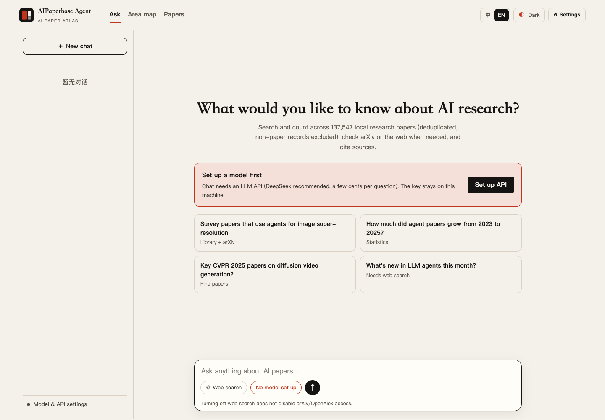
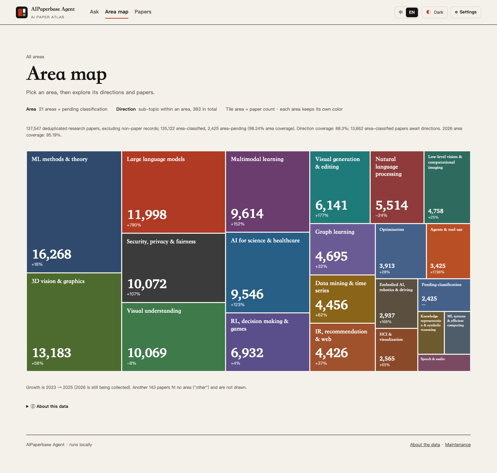
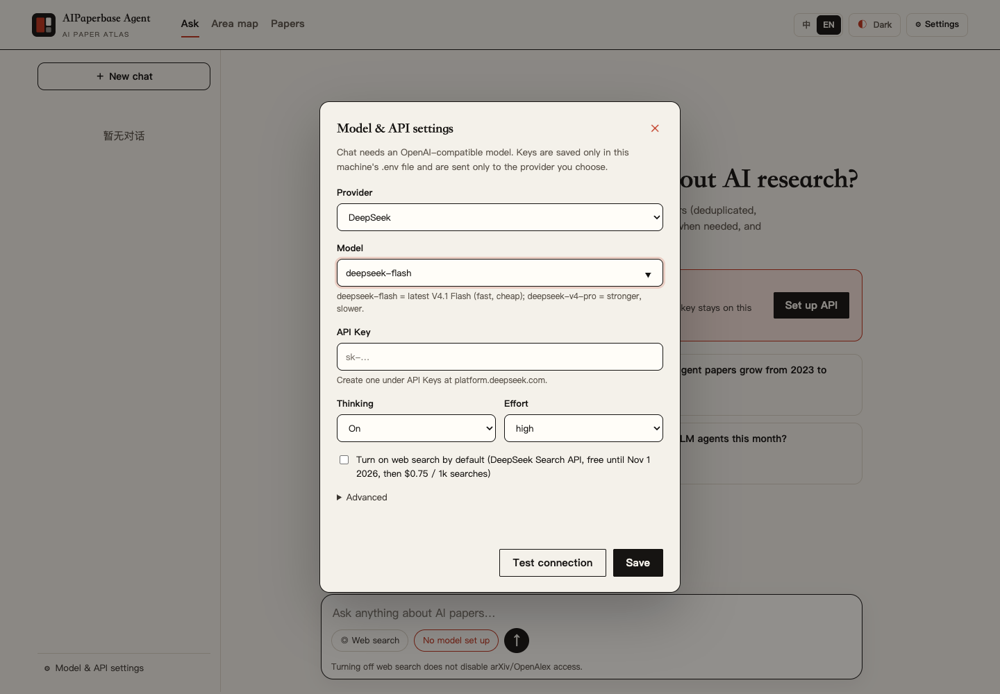

# AIPaperbase Agent

> 中文版：[README.zh-CN.md](./README.zh-CN.md)

A local research assistant over about **138,000 deduplicated research papers from 30 top AI conferences and journals (2023–2026)**. Ask questions in plain language, explore the field as an area map, and search papers. Every answer shows the papers it is based on.

> **Status:** personal project, actively developed.



## What you can do

- **Ask.** A chat agent searches the local library, counts papers and trends, looks up arXiv and OpenAlex, and can search the web when you switch it on. You watch each step live, the answer streams in with numbered citations, and every source is listed. Conversations stay on your machine: rename, archive, move to Deleted and restore, or restore earlier versions.
- **Explore the area map.** 21 areas → 383 directions → papers. The map is a treemap sized by paper count; each area shows its 2023–2026 trend, top venues and newest papers.
- **Search papers.** Keyword, area, venue and year filters; save papers into your own collections. Optionally download PDFs, parse them and ask questions over the full text.
- **Use it from your own agent.** The same search and statistics are exposed as an MCP server (11 tools) for Claude Code, Codex, Cursor and others.

| Area map | Settings |
|---|---|
|  |  |

## Quick start

Requirements: **Python 3.12+** on macOS or Linux (on Windows use WSL).

```bash
git clone https://github.com/szxiulin/aipaperbase-agent.git
cd aipaperbase-agent
./run.sh
```

The first run creates `.venv`, installs one small dependency (`httpx`) and builds the paper library from the CSV files in the repository. Expect 2–5 minutes and about 1 GB of disk. Later starts take seconds. Then open <http://127.0.0.1:8765>.

The area map and paper search work right away, with no key. **To chat**, click **⚙ Settings** in the top-right corner, paste a [DeepSeek API key](https://platform.deepseek.com/api_keys), click **Test connection**, then **Save**. The key is written only to the local `.env` file.

Language (中 / EN) and light / dark mode are in the top-right corner.

### Upgrade an existing installation

Stop the server and keep a backup of your user data, then update and rebuild:

```bash
git pull --ff-only
.venv/bin/python -m backend.catalog.import_csv
./run.sh
```

The rebuild retains the previous database and leaves conversations and collections under `data/user/` untouched. Pulling code alone does not update an existing database. If rebuilding fails, preserve the files and investigate; do not clear user data.

### Install with a coding agent

Paste this into Claude Code, Codex, Cursor or another agent that can use a terminal:

```text
Install and start AIPaperbase Agent for me: https://github.com/szxiulin/aipaperbase-agent

1. Clone it into the current directory. If it already exists, check its state first and keep my changes.
2. Make sure Python 3.12+ is available, then run ./run.sh in a persistent terminal. The first start builds
   the paper library (2–5 minutes, about 1 GB); wait until the server prints its URL.
3. Check http://127.0.0.1:8765/api/summary and tell me the page URL and the entity_count it reports.
4. Do not create or read .env, do not enter any API key, and do not call paid APIs. I will add the key in Settings.
5. Do not modify project code. If something fails, keep all files and report the exact error.
```

## Models and cost

- Chat works with any **OpenAI-compatible** model. The default is DeepSeek `deepseek-flash` (V4.1 Flash: fast and cheap); `deepseek-v4-pro` is stronger and slower. Choose **Other OpenAI-compatible** in Settings to use another provider.
- A simple question takes a few tool calls. A literature survey can take 20+ calls and about 250k tokens. Thinking mode and its effort level are set in Settings.
- **Web search** uses the [DeepSeek Search & Fetch API](https://api-docs.deepseek.com/guides/search/) and is off unless you switch it on for a message. It is free until 2026-11-01 (Beijing time), then US$0.75 per 1,000 successful calls.
- `GENERATOR_TOKEN_BUDGET` in `.env` caps the tokens one server process may spend.

## Privacy

- The paper library, statistics and area map run entirely on your machine.
- Chat sends your question and the retrieved paper metadata to the model provider you configure. With web search on, search queries also go to DeepSeek. arXiv and OpenAlex lookups go to those public APIs.
- API keys are stored only in `.env` (ignored by git). The page shows only the last four characters, and the settings endpoint accepts requests only from the app's own page.
- Conversations, collections, downloads and notes live under `data/user/` and other ignored folders; they are never committed.

## The data

- **Version and scope:** `local-20261022-M1`; publication audit cutoff 2026-10-21, classification updated 2026-10-22. Mainly 20 conferences and 10 journals, 2023–2026. 138,755 source records form 137,831 entities, or **137,547 deduplicated research papers** after excluding 284 non-paper entities. Canonical records lack 2,909 abstracts and 966 author lists; unknown fields remain empty.
- **Completeness:** of 120 venue-year combinations, 50 specified formal inventories are reconciled, 62 remain incomplete and 8 are not applicable. This does not establish complete publisher coverage. The 2026 collection is ongoing. Annals of Statistics contributes only 5 conference-linked journal presentations, not the whole journal.
- **Areas:** 135,122 papers have area labels (98.24%); 2,425 remain pending. The taxonomy uses 21 areas plus Other (`data/labels/areas-v1.5.csv`). The new 13,662 assignments were model-reviewed against titles, abstracts and locatable evidence; uncertain cases remain pending.
- **Direction coverage:** 121,460 papers have directions (88.3%); 13,662 have an area but await a direction, accessible from each area's page.
- **Directions:** 383 sub-topics found by clustering the papers' research tasks inside each area (`data/labels/directions-v1.1.csv`). Names were drafted by an LLM; 25 have been confirmed by hand.
- **Quality:** a stratified sample of 399 papers was reviewed by an AI agent with the system labels as reference: area accuracy 97.0% (95% CI 94.8–98.3%). This is an AI-agent review estimate, not human gold; it does not evaluate the new increment.
- **Sources:** public paper lists of each venue plus open metadata from Hugging Face ai-conferences, OpenAlex, ACL Anthology, OpenReview and Crossref. No PDFs are distributed. Check each source's terms before redistributing derived data.

## Use it from your agent (MCP)

The MCP server needs only the Python standard library and reads the same database:

```json
{
  "mcpServers": {
    "aipaperbase": {
      "command": "/path/to/aipaperbase-agent/.venv/bin/python",
      "args": ["-m", "backend.mcp_server"],
      "env": { "PYTHONPATH": "/path/to/aipaperbase-agent" }
    }
  }
}
```

Tools: `search_papers`, `get_paper`, `sample_papers`, `count_papers`, `share`, `trend`, `compare`, `top_values`, `cooccurrence`, `recall_topic`, `list_taxonomy`. The same capabilities are available over HTTP at `POST /api/cap/<name>`.

## Optional: full-text Q&A over your own PDFs

To download PDFs for a collection, parse them and ask questions over the full text:

```bash
.venv/bin/pip install -r requirements-rag.txt
docker run -d -p 6333:6333 qdrant/qdrant
# then fill MINERU_TOKEN, EMBEDDING_* and (optionally) RERANKER_* in .env — see .env.example
```

## Repository layout

| Path | What it is |
|---|---|
| [`backend/`](./backend/README.md) | Python backend: catalog import and paper merging, capabilities (shared by web, HTTP and MCP), chat agent and tools, collections, library, HTTP API |
| [`frontend/`](./frontend/README.md) | Web app (vanilla JS, no build step) |
| [`raglib/`](./raglib/) | Reusable RAG core for full-text Q&A |
| [`data/catalog/`](./data/catalog/README.md) | Venue paper lists (CSV), the source the library is built from |
| `data/labels/` | Area and direction labels, the review sample and its metrics |
| [`config/`](./config/README.md) | Area and direction definitions |
| [`scripts/`](./scripts/README.md) | Maintainer tools: collectors, labeling, benchmarks, acceptance checks |
| [`tests/`](./tests/README.md) | `unittest` suite: `.venv/bin/python -m unittest discover -s tests -p 'test_*.py'` |

## Known limits

- Library search matches keywords in titles and abstracts (in English). A synonym the paper does not use can be missed; the agent searches several phrasings to compensate.
- Area and direction labels come from LLMs; some papers are misfiled, and there is no independent human gold evaluation of the new assignments, and review agreement is not accuracy.
- Answers depend on the model you choose. Check important claims against the cited papers.

## License

The code is released under the [MIT License](./LICENSE). The paper metadata in `data/catalog/` comes from the public sources listed above and remains subject to their own terms; the label files in `data/labels/` are provided under the same MIT terms as the code.
