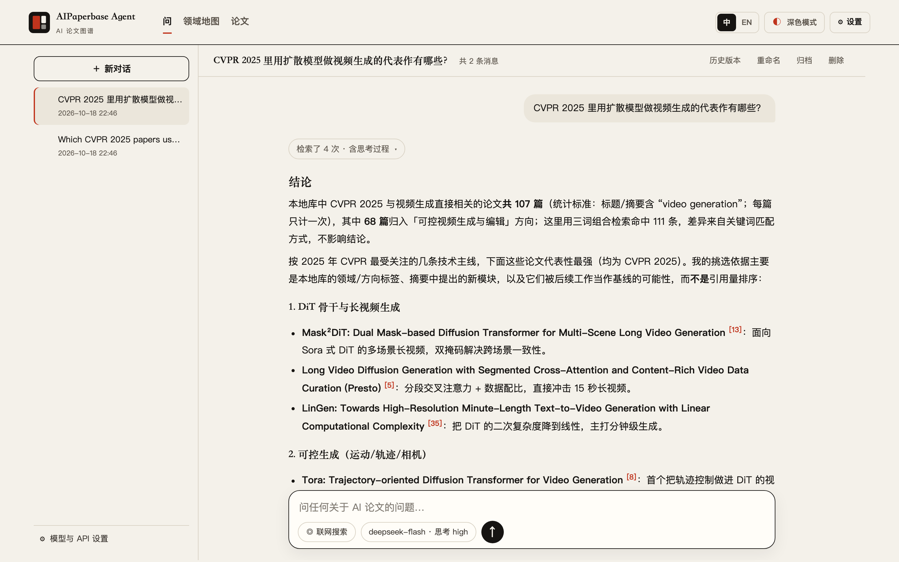
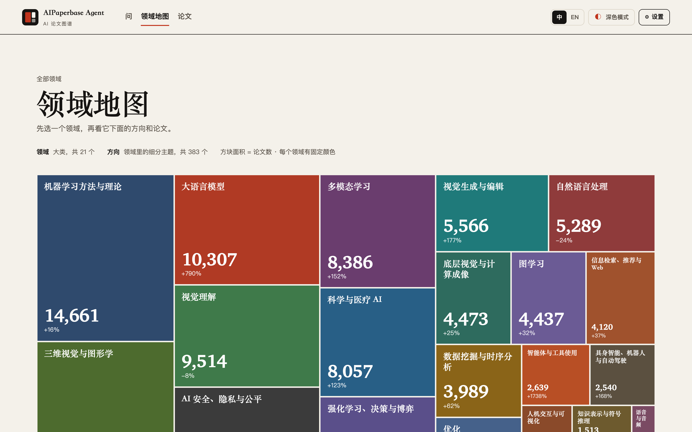
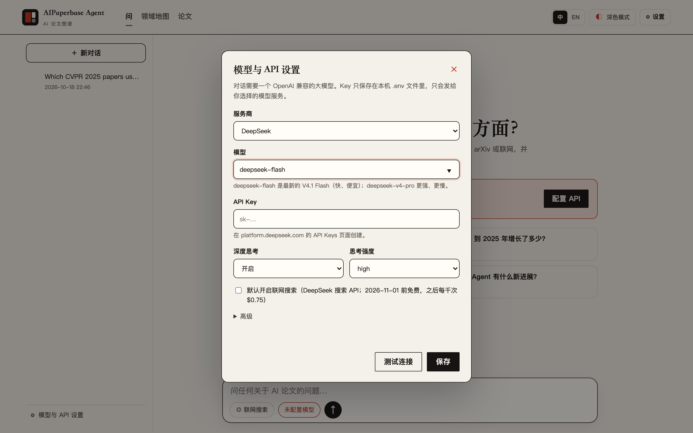

# AIPaperbase Agent

> English: [README.md](./README.md)

一个在本机运行的 AI 论文研究助手，收录 **30 个顶会顶刊 2023–2026 年约 12 万篇论文**。可以直接提问、按领域地图浏览、搜索论文；每个回答都附上依据的论文。

> **状态：** 个人项目，持续开发中。



## 能做什么

- **问。** 对话 Agent 会在本地论文库里检索、统计数量和趋势，查 arXiv 和 OpenAlex；打开“联网搜索”后还能搜网页。每一步检索实时可见，回答逐字生成并带编号引用，来源逐条列出。对话保存在本机，可重命名、归档、删除、恢复历史版本。
- **看领域地图。** 21 个领域 → 383 个方向 → 论文。地图是按论文数排布的树状面积图；每个领域可以看 2023–2026 趋势、主要会议和最新论文。
- **搜论文。** 按关键词、领域、会议、年份筛选，把论文存进自己的集合；可选下载 PDF、解析后做全文问答。
- **接进你自己的 Agent。** 同样的检索和统计以 MCP 服务提供（11 个工具），可接入 Claude Code、Codex、Cursor 等。

| 领域地图 | 设置 |
|---|---|
|  |  |

## 快速开始

环境要求：**Python 3.12+**，macOS 或 Linux（Windows 请用 WSL）。

```bash
git clone https://github.com/szxiulin/aipaperbase-agent.git
cd aipaperbase-agent
./run.sh
```

首次运行会创建 `.venv`、安装一个小依赖（`httpx`），并用仓库里的 CSV 构建论文库，约 2–5 分钟、占用约 1 GB；之后启动只需几秒。然后打开 <http://127.0.0.1:8765>。

领域地图和论文搜索无需任何 Key 即可使用。**要对话**，点右上角 **⚙ 设置**，粘贴 [DeepSeek API Key](https://platform.deepseek.com/api_keys)，点 **测试连接**，再点 **保存**。Key 只写入本机 `.env` 文件。

右上角可以切换中 / EN 和深浅色。

### 让编程 Agent 帮你安装

把下面这段交给 Claude Code、Codex、Cursor 等能操作终端的 Agent：

```text
帮我安装并启动 AIPaperbase Agent：https://github.com/szxiulin/aipaperbase-agent

1. 克隆到当前目录。如果目录已存在，先检查状态并保留我的改动。
2. 确认有 Python 3.12+，在持续运行的终端里执行 ./run.sh。首次启动会构建论文库（2–5 分钟、约 1 GB），等服务打印出地址。
3. 访问 http://127.0.0.1:8765/api/summary，告诉我页面地址和返回的 entity_count。
4. 不要创建或读取 .env，不要填写任何 API Key，不要调用付费接口；Key 我会在设置里自己填。
5. 不要修改项目代码。出错时保留现有文件，原样报告错误。
```

## 模型与费用

- 对话支持任何 **OpenAI 兼容** 的模型。默认 DeepSeek `deepseek-flash`（V4.1 Flash，快、便宜）；`deepseek-v4-pro` 更强、更慢。在设置里选“其他 OpenAI 兼容服务”即可换服务商。
- 简单问题只需几次工具调用；整理一个方向的文献可能调用 20 次以上、约 25 万 token。深度思考和思考强度在设置里调。
- **联网搜索** 使用 [DeepSeek Search & Fetch API](https://api-docs.deepseek.com/guides/search/)，只有在某条消息打开开关时才会使用。2026-11-01（北京时间）前免费，之后每 1,000 次成功调用 0.75 美元。
- `.env` 里的 `GENERATOR_TOKEN_BUDGET` 可以限制一个服务进程最多花多少 token。

## 隐私

- 论文库、统计和领域地图完全在本机运行。
- 对话会把你的问题和检索到的论文信息发给你配置的模型服务；开启联网搜索时，搜索词还会发给 DeepSeek；arXiv、OpenAlex 检索会访问这两个公开 API。
- API Key 只保存在 `.env`（已被 git 忽略）；页面只显示后 4 位，设置接口只接受本页面发出的请求。
- 对话、集合、下载和笔记保存在 `data/user/` 等被忽略的目录里，不会被提交。

## 数据

- **覆盖：** 20 个会议、10 个期刊，2023–2026 年；122,571 条清单记录合并为 **121,742 篇论文**（预印本和正式发表只算一次）。251 条非论文记录（编委名单、目录、勘误等）不计入统计；8,316 篇没有摘要；2026 年还在收录中。
- **领域：** 每篇论文属于 21 个领域之一，由大模型根据标题和摘要标注（`data/labels/areas-v1.5.csv`；约 82% 用 Codex/GPT，其余用 DeepSeek）。
- **方向：** 在每个领域内对论文的研究任务做聚类，得到 383 个方向（`data/labels/directions-v1.1.csv`）。方向名由大模型起草，其中 25 个已人工确认。
- **质量：** 分层抽样 399 篇，由 AI 代理以系统标签为参照复核：领域准确率 97.0%（95% 置信区间 94.8–98.3%）。这不是独立的人工评测，请当作估计值。
- **来源：** 各会议/期刊公开论文列表，以及 Hugging Face ai-conferences、OpenAlex、ACL Anthology、OpenReview、Crossref 等公开元数据。不分发 PDF；再分发衍生数据前请查看各来源的使用条款。

## 接进你的 Agent（MCP）

MCP 服务只依赖 Python 标准库，读取同一个数据库：

```json
{
  "mcpServers": {
    "aipaperbase": {
      "command": "/path/to/aipaperbase-agent/.venv/bin/python",
      "args": ["-m", "backend.mcp_server"],
      "env": { "PYTHONPATH": "/path/to/aipaperbase-agent" }
    }
  }
}
```

工具：`search_papers`、`get_paper`、`sample_papers`、`count_papers`、`share`、`trend`、`compare`、`top_values`、`cooccurrence`、`recall_topic`、`list_taxonomy`。同样的能力也可以通过 HTTP `POST /api/cap/<name>` 调用。

## 可选：对自己的 PDF 做全文问答

要为集合下载 PDF、解析并做全文问答：

```bash
.venv/bin/pip install -r requirements-rag.txt
docker run -d -p 6333:6333 qdrant/qdrant
# 然后在 .env 里填写 MINERU_TOKEN、EMBEDDING_*，以及可选的 RERANKER_*（见 .env.example）
```

## 目录结构

| 路径 | 内容 |
|---|---|
| [`backend/`](./backend/README.md) | Python 后端：论文库导入与合并、能力层（网页 / HTTP / MCP 共用）、对话 Agent 与工具、集合、全文库、HTTP API |
| [`frontend/`](./frontend/README.md) | 网页应用（原生 JS，无需构建） |
| [`raglib/`](./raglib/) | 全文问答用的 RAG 核心库 |
| [`data/catalog/`](./data/catalog/README.md) | 各会议/期刊论文列表（CSV），论文库的构建来源 |
| `data/labels/` | 领域与方向标签、复核样本及指标 |
| [`config/`](./config/README.md) | 领域与方向定义 |
| [`scripts/`](./scripts/README.md) | 维护者工具：采集、标注、基准、验收 |
| [`tests/`](./tests/README.md) | `unittest` 测试：`.venv/bin/python -m unittest discover -s tests -p 'test_*.py'` |

## 已知限制

- 本地检索按标题和摘要里的英文关键词匹配，论文没用到的同义说法可能漏掉；Agent 会换几种说法检索来弥补。
- 领域和方向标签来自大模型，有少量错分；约 30 条勘误仍计入统计。
- 回答质量取决于你选的模型；重要结论请对照引用的论文核实。
